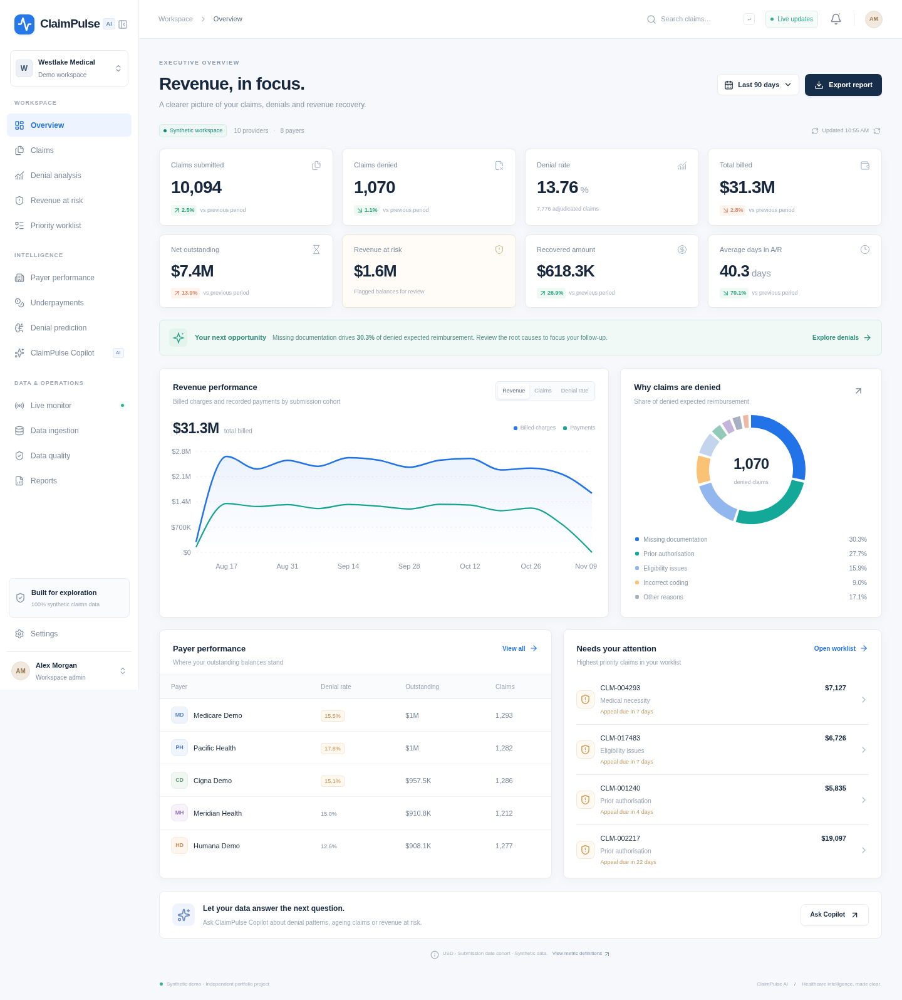
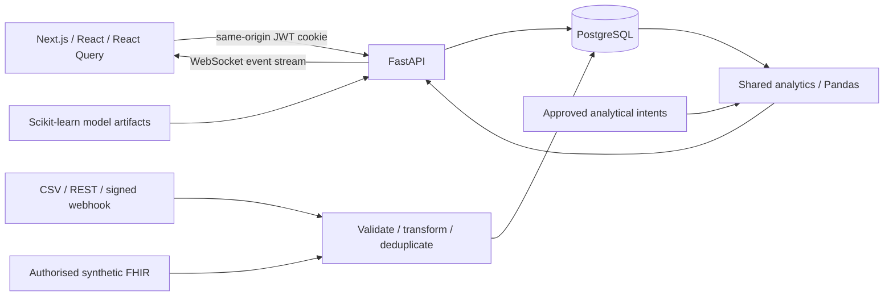

# ClaimPulse AI

**Healthcare Claims Intelligence & Revenue Recovery Analytics Platform**

An independent full-stack portfolio application that connects claim operations, denial analysis, A/R ageing, explainable priorities and experimental denial prediction. Built with Next.js, FastAPI and PostgreSQL; usable without paid API keys.

> **Synthetic data only.** The demonstration starts with 20,000 reproducible synthetic claims. It cannot guarantee claim approval, replace certified medical coders, make medical or coverage decisions, or automatically recover revenue. No HIPAA certification or compliance is claimed.



## 1. Project overview

ClaimPulse turns stored claim records into a traceable operational view. An analyst can follow a balance from a dashboard card to a claim, review its denial history, assign an owner, record a follow-up and see validated events update connected browser sessions.

## 2. Business problem

Healthcare revenue teams face denied claims, missing documentation, coding review needs, delayed reimbursement and fragmented follow-up queues. A total alone does not explain which claims need attention or why. This project explores how analytics can make those decisions easier to inspect.

## 3. Why I built this

The portfolio demonstrates the connection between an RCM business problem and an end-to-end engineering solution: metric design, normalised data, ingestion validation, reproducible models and an interface that can be traced back to underlying records. It is independently implemented and is not a clone of proprietary healthcare software.

## 4. How ClaimPulse AI helps

- Understand historical denial reasons and their contribution to denied expected reimbursement.
- Review current outstanding balances, ageing buckets and appeal deadlines.
- Prioritise follow-up using transparent components and retain human overrides.
- Compare synthetic payer patterns with visible sample sizes and denominators.
- Ask a controlled analytics assistant for calculated answers and supporting claim links.

No unmeasured savings, approval improvement or recovered-revenue impact is claimed.

## 5. Key features

| Workspace            | Working behaviour                                                                                                                        |
| -------------------- | ---------------------------------------------------------------------------------------------------------------------------------------- |
| Executive dashboard  | Eight database-derived KPIs, date ranges, previous-period comparisons, revenue/claim/denial charts, reasons and priorities               |
| Claims management    | Search, payer/status/date/amount filters, sorting, pagination, creation, financial review edits, valid status transitions and CSV export |
| Claim detail         | Payments, denial/appeal history, rule components, assignment, manual priority, notes and follow-up actions                               |
| Denial analysis      | Pareto, frequency, denied expected reimbursement, trends and payer/provider/speciality drill-down                                        |
| Revenue risk         | Five ageing buckets, outstanding balances, high-value priorities and deadline views                                                      |
| Payer performance    | Comparison filters, observed denial/reimbursement/recovery metrics and transparent scorecards                                            |
| Underpayments        | Adjudicated reimbursement gaps under an explicit synthetic 72% contract assumption                                                       |
| Prediction           | Logistic Regression and Random Forest, chronological split, leakage safeguards, measured metrics and inference API                       |
| Copilot              | Six approved analytical intents, deterministic fallback, evidence tables, period and links                                               |
| Live monitor         | Start/pause/stop simulator, event frequency/count, persisted lifecycle events and WebSockets                                             |
| Ingestion & quality  | CSV, authenticated REST batches, signed webhook, opt-in synthetic FHIR polling, duplicates/rejections and error CSV                      |
| Reporting & settings | Seven CSV report types, printable executive report, source ZIP, alert thresholds, read markers, dark appearance and audit history        |

Required routes: `/login`, `/register`, `/dashboard`, `/claims`, `/claims/[id]`, `/denials`, `/revenue-risk`, `/claim-prioritisation`, `/payer-performance`, `/underpayments`, `/predictive-analytics`, `/copilot`, `/live-monitor`, `/data-ingestion`, `/data-quality`, `/reports`, `/settings`.

## 6. Architecture



Detailed design: [architecture](docs/architecture.md), [business problem](docs/business_problem.md), [data dictionary and ER diagram](docs/data_dictionary.md).

## 7. Technology stack

**Frontend:** Next.js 15, React 19, TypeScript, Tailwind CSS 4, shadcn-style Radix/CVA Button and Dialog primitives, Recharts, TanStack React Query, React Hook Form, Zod, Lucide and Sonner.

**Backend:** Python 3.12, FastAPI, Pydantic, SQLAlchemy 2, Alembic, Pandas, NumPy, Argon2/password hashing and JWT sessions.

**Data & ML:** PostgreSQL 17, scikit-learn pipelines, Logistic Regression, Random Forest and joblib artifacts. WebSockets plus bounded asynchronous background simulator and scheduled FHIR worker. Redis is not required for the single-process demo; shared pub/sub is a documented scaling requirement.

**Quality & packaging:** Pytest, Vitest, Playwright, Docker Compose, GitHub Actions verification and an explicitly dispatched container release workflow.

## 8. Database design

21 tables cover users/roles, synthetic provider/payer/patient references, claims/lines, procedures/diagnoses, denials/payments/appeals, notes/assignments/events/recovery actions, underpayments, sources/jobs, audit logs and notifications. Foreign keys, financial checks, unique IDs and cohort indexes protect relationships. Six analytical SQL views expose claim summaries, denials, payer performance, ageing, risk and recovery.

See [data dictionary](docs/data_dictionary.md). Alembic revisions create and update the schema; no SQLite substitution is used.

## 9. Data engineering pipeline

Extract → validate → transform → deduplicate → load in transactional savepoints → record quality job → notify browsers. Invalid records never silently replace existing claims. Each accepted claim retains source and ingestion timestamps. Upload validation checks dates, positive/reconciled amounts, synthetic references, known payer/provider keys and consistent lifecycle states. Unknown CSV columns are rejected; raw rejected payloads are not retained.

[Dataset instructions](data/README.md), [sample CSV](data/samples/claims.csv), current-date template in the application.

## 10. Machine learning approach

Historical adjudicated claims have a binary label derived from denial history. Features are restricted to payer, speciality, original amount, broad procedure/diagnosis categories, authorisation, documentation, eligibility, prior denial count and submission lag. Denial reason, payment, current status, appeal deadline and recovery outcome are excluded from predictors.

Chronological 60/20/20 partitions prevent future submission cohorts from leaking into earlier ones. Missing-value imputation and categorical encoding live inside each pipeline. Class weights address imbalance. Validation ROC-AUC selects the model; it is then refit on train + validation and measured once on held-out test data. UI includes precision, recall, F1, ROC-AUC, confusion matrix, permutation importance and local sensitivity on review flags.

Observed synthetic run: Logistic Regression validation ROC-AUC **0.7165**; held-out test ROC-AUC **0.6869**, precision **0.2435**, recall **0.5928**, F1 **0.3452** on 3,269 test records. Random Forest test ROC-AUC **0.6721**. These modest, measured synthetic results are reported without inflating business impact. Balanced-model estimates are not real-world calibrated denial probabilities.

## 11. Analytics and KPI definitions

Denial rate uses **historically denied claims / adjudicated outcomes**, not all submissions. Recovery comes from payment-ledger recovery flags, including claims later closed. Net outstanding subtracts payments and contractual adjustments and excludes Drafts in operational A/R. Underpayments are not inferred from billed charges alone.

Full formulas, examples, score components, cohort conventions and limitations: [metric definitions](docs/metric_definitions.md).

## 12. Real-time data architecture

The bounded simulator creates synthetic claims, moves them through validated states and writes payments/denials/appeals before broadcasting events. Authenticated WebSockets invalidate React Query views. Start/pause/stop, event frequency and generated-claim count are operational controls; persisted events remain available after stopping. Every source is labelled. There is no pretend live insurer connection.

CSV, REST and webhook batches share the ingestion pipeline. FHIR polling is disabled until an authorised synthetic endpoint is configured. Public CMS/NPPES adapters fetch reference metadata separately; CMS data is not an individual denial event stream.

## 13. Screenshots

- [Executive overview](screenshots/dashboard.png)
- [Sign-in](screenshots/login.png)
- [Claims](screenshots/claims.png), [claim detail](screenshots/claim-detail.png), [denials](screenshots/denials.png), [prediction](screenshots/predictive-analytics.png), [Copilot](screenshots/copilot.png), [ingestion](screenshots/data-ingestion.png) and [mobile](screenshots/mobile-dashboard.png).
- Demo recording: add a hosted walkthrough link when publishing the portfolio.

## 14. Installation

Recommended: Docker Engine/Desktop with Compose v2. For direct development also install Node 22+ and Python 3.12.

```bash
python scripts/configure.py
docker compose up --build -d
```

The configuration script generates unique local secrets and never prints them. `.env` is ignored by Git. First startup applies migrations, seeds 20,000 claims and trains the demonstration model.

## 15. Environment variables

`.env.example` documents all variables. Required: DATABASE_URL and JWT_SECRET; Compose also uses POSTGRES_USER/DB/PASSWORD. Optional: DEMO_MODE, COOKIE_SECURE, CORS_ORIGINS, SEED_COUNT, FHIR_BASE_URL/TOKEN, POLL_SECONDS, WEBHOOK_SECRET, AI_PROVIDER/BASE_URL/API_KEY/MODEL, ARTIFACTS_DIR and port variables. No real secret values are included.

## 16. Running locally

Open **http://localhost:3000** and choose **Enter synthetic demo**. Alternatively register an analyst account with a password of at least 12 characters. The demo account has synthetic admin access; no committed password is needed. Disable demo access outside a sandboxed portfolio demonstration.

For separate Python/Next.js development commands, database setup and production host configuration see [deployment instructions](docs/deployment.md).

## 17. API documentation

Interactive docs: **http://localhost:8000/api/docs**. OpenAPI schema: `/api/openapi.json`. [API reference](docs/api_documentation.md) documents filters, transitions, CSV, webhook signing and routes. HTTP claims ingestion supports a session cookie or bearer JWT; WebSockets use the authenticated cookie.

## 18. Testing

```bash
cd backend
../.venv/bin/pytest -q
cd ../frontend
npm test
npm run typecheck
npm run build
# With backend and frontend running:
npm run test:e2e
```

Backend tests use a dedicated PostgreSQL `claimpulse_test` database, never the demo data. Fixtures verify auth/roles, transitions/ledgers, financial and denial denominators, ageing, payer reconciliation, ingestion, duplicates, model inference, WebSockets, Copilot and privacy of source archives. Playwright covers navigation, claim actions, CSV quality, Copilot, simulation, exports, mobile and registration. [Verification log](docs/verification.md) records observed results and limits.

## 19. Security and privacy

Synthetic records only, Argon2 password hashes, JWT HttpOnly cookies, logout revocation, role checks, origin validation, request rate limits, Pydantic validation, audit trails, bounded uploads and signed webhooks. Registered users cannot select admin roles. Integration secrets stay on the server. CSV exports guard spreadsheet-leading formulas. Source downloads exclude `.env`, models, dependencies and runtime state.

No HIPAA claim is made. Production clinical use would require additional legal, security, organisational and contractual controls. See [limitations](docs/limitations.md) before interpreting this prototype as a deployable healthcare system.

## 20. Dataset sources

The full **20,000-claim synthetic dataset** is included in [data/synthetic/claimpulse_seed_42.zip](data/synthetic/claimpulse_seed_42.zip), with 13 CSV tables covering claims, payments, denials, appeals, lifecycle events and reference data. See the [100-row preview](data/synthetic/claims_preview.csv), [manifest](data/synthetic/manifest.json) and [dataset instructions](data/synthetic/README.md). Run `python scripts/verify_synthetic_data.py` to verify checksums, relationships and balances.

Built-in seed data is independently generated with seed 42, not a private claims dataset. Reference documentation: [CMS](https://data.cms.gov/), [CMS Provider Data Catalog](https://data.cms.gov/provider-data/), [Synthea](https://synthetichealth.github.io/synthea/), [NPPES](https://npiregistry.cms.hhs.gov/) and [FHIR R4](https://www.hl7.org/fhir/R4/claim.html). CMS returned HTTP 403 in this environment; the adapter reports the failure. NPPES organisation search was reachable. No external clinical credentials are required or configured.

## 21. Limitations

Single synthetic workspace and single backend process; in-process limiter/pubsub; bounded in-request batch ingestion; experimental uncalibrated models; no real contract library, payer connectivity, patient data, payment reversals or distributed queue. Current diagrams and instructions distinguish implemented paths from future scaling work. [Detailed limits](docs/limitations.md).

## 22. Future improvements

Multi-tenant identity and SSO, shared Redis queue/pubsub, distributed ingestion workers, SQL/materialized aggregate reporting, calibrated externally validated models, governed authorised FHIR mappings, line-level remittance/contract logic, payment reversal reconciliation and operational observability. Each requires additional validation rather than assumed business benefit.

## 23. Author

**[Abhinav Gautam](https://github.com/abhinavgautam121)** · ClaimPulse AI portfolio project.

Alex Morgan and other in-app team names are synthetic demonstration accounts.

Licensed under [MIT](LICENSE).
