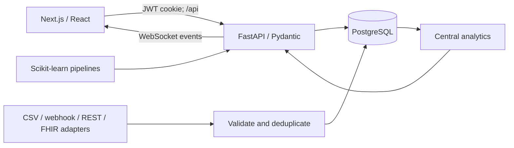

# Architecture

Next.js App Router + React Query → same-origin /api proxy → FastAPI → PostgreSQL.
FastAPI also publishes authenticated WebSocket events. A bounded background task drives the synthetic simulator and optionally polls an explicitly configured authorized FHIR endpoint. SQLAlchemy transactions cover claim mutations and their payment, denial, audit and event records. Alembic owns the schema and analytical views. No paid service is required.

## Implementation plan and verification gates

1. Architecture and skeleton: validate project configuration.
2. Schema and reproducible 20,000-claim seed: migrations, relationship and balance checks.
3. APIs and auth: JWT, Argon2, role checks and session tests.
4. Claims: create/edit/transitions, filtering, CSV round trip.
5. Analytics: reconcile known-record metrics and database aggregates.
6. Risk and worklist: score component and assignment/note tests.
7. ML: chronological held-out evaluation, model persistence and inference tests.
8. Ingestion and live updates: validation, duplicate, simulator and WebSocket tests.
9. Copilot: approved intent queries, evidence and unsupported-question tests.
10. Release: backend tests, frontend type check/build, browser journeys, Docker configuration.
11. Documentation: screenshots, data dictionary, API/security/deployment instructions.

Each gate is recorded in docs/verification.md. The app is an independent synthetic portfolio prototype; it does not automate payer decisions or guarantee recovery.
