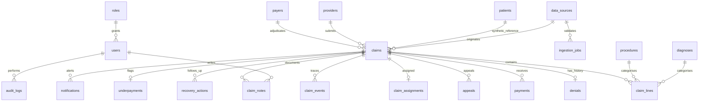

# Data dictionary

Money fields use PostgreSQL `NUMERIC(14,2)`, input validation uses Decimal and transactions, and all references have foreign keys. Data is synthetic by database constraint. Claim IDs are source-stable deduplication keys. `created_at` and `updated_at` are timezone-aware timestamps on transactional entities; `ingested_at` records ingestion time independently of submission/service dates. Indexed cohort columns: submission_date, status, payer_id; separate provider, patient, deadline and event indexes support drill-down.

| Table | Purpose and key fields |
|---|---|
| users | Unique normalized email, Argon2 password hash, role_id, active, token_version, preferences JSON; no stored plaintext passwords |
| roles | admin or analyst |
| providers | Synthetic organisation name and speciality; not actual provider performance |
| payers | Synthetic payer labels, all marked synthetic |
| patients | Only SYN- reference ID and synthetic=true; no patient name, DOB, address or identifiers |
| claims | Financial totals, submission/service dates, payer/provider/patient/source FKs, lifecycle, deadline, review flags and ingestion provenance |
| claim_lines | Claim FK, synthetic procedure/diagnosis references and billed amount |
| diagnoses | SYN-D codes and broad synthetic diagnosis categories; not clinical coding guidance |
| procedures | SYN-P codes and broad procedure categories; not proprietary CPT content |
| denials | One historical initial denial per claim, reason, expected denied insurer amount and denial date |
| payments | Append-only positive payment entries, payment date and recovered flag; totals reconcile to claims.paid_amount |
| appeals | Filed/resolved dates and Pending/Successful/Unsuccessful outcome; only successful recovery produces a recovered payment |
| claim_notes | Team notes with author FK and timestamps; synthetic context only |
| claim_assignments | One current assignee/priority override/recovery follow-up state per claim |
| claim_events | Claim lifecycle/activity messages, source label and structured non-secret details |
| recovery_actions | Dated, authored follow-up actions; distinct from payment receipt |
| underpayments | Current synthetic assumption-based adjudicated reimbursement gaps |
| ingestion_jobs | Source, filename, processed/valid/rejected/duplicate/missing counts and bounded validation messages; no raw rejected patient payloads |
| data_sources | Adapter kind, current status, last successful sync and reference metadata |
| audit_logs | Actor/action/entity and structured fields changed; never request passwords or secret values |
| notifications | Claim or ingestion/pattern alerts with priority, type and per-user read markers |

## Entity relationships

## Provenance and source labels

Synthetic Simulator, Uploaded CSV, Connected API, Webhook Integration and FHIR R4 denote the ingestion path, not clinical authenticity. **All stored claim records remain synthetic**. CMS/NPPES reference records are stored separately as source metadata; public organisation names never imply actual claim relationships. Seed payer labels containing familiar insurance names are explicitly demonstration records.
